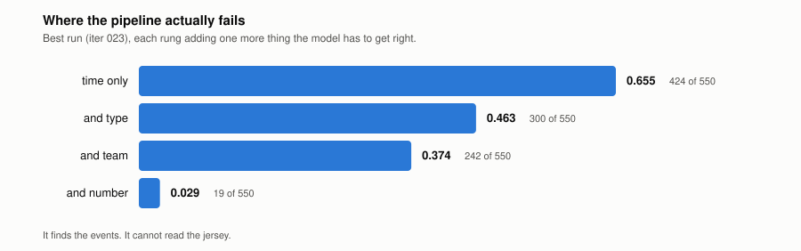
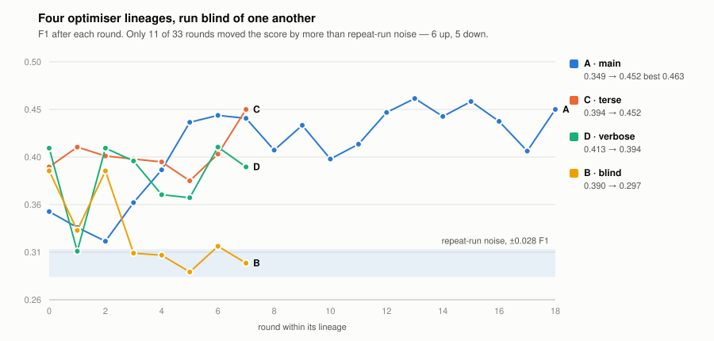
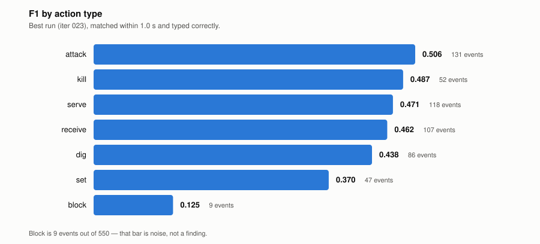

# A vision pipeline that diagnoses itself

**Gemini 3.7 Flash reads a volleyball match. A second agent reads the scoreboard of its own
failures, forms a hypothesis, commits a falsifiable prediction to disk, changes one thing, and
is graded on numbers it cannot edit.**

62 minutes of real match footage from a fixed camera. A human scout recorded 550 events —
every serve, receive, dig, set, attack, kill and block, with a timestamp, a team and a jersey
number. The job is to reproduce that sheet automatically, and then to find out whether a
language model can work out *why* its own pipeline is wrong.

52 scored runs. 4 independent optimiser lineages. Every prediction written to disk before its
result existed.

---

## The result

```
                                    F1     found   named   +team
best configuration               0.463    419/550   293     229
starting configuration           0.342    321/550   202     147
```

**F1 = 2·TP / (n_pred + 550)**, where a true positive means the model put an event within
1.0 s of a real one *and* named the action correctly.

<picture>
  <source media="(prefers-color-scheme: dark)" srcset="docs/ladder-dark.svg">
  
</picture>

Each rung adds one more thing the model has to get right. It finds the events. It cannot read
the jersey — 19 of 550, which is the honest ceiling on anything that needs a named player.

The interesting finding is not the score. It is what happened when four optimiser lineages ran
**blind** — separate notebooks, separate results stores, no sight of one another — from four
different starting points:

```
rule reached independently        A     B     C     D
set = assist only                yes   yes   yes   yes
attack = over the net            yes   yes   yes   yes
don't assume a rally sequence    yes   yes   yes   yes
ignore dead time                 yes   yes   yes   yes
```

Their final prompts share **3–14 % of their text**. Four dissimilar documents encoding the same
four rules. Convergence appears in what is *learned*, not in what is written.

<picture>
  <source media="(prefers-color-scheme: dark)" srcset="docs/lineages-dark.svg">
  
</picture>

And the honest other half: of 33 rounds across the blind lineages, only 11 moved the score by
more than the ±0.028 repeat-run noise, and those split 6 up / 5 down. **It is a good
diagnostician and a mediocre optimiser.** Both halves are in the write-up. The noise band is
drawn to scale above — most rounds do not clear it, and lineage B ends below where it started.

---

## Architecture

```
                         ┌──────────────────────────────────────────┐
   62 min of video ─────▶│ ffmpeg: cut to N-second overlapping clips│
   1920×1080 fixed cam   │ crop → scale → sample at F fps           │
                         └────────────────┬─────────────────────────┘
                                          │  930 clips at 6 s
                                          ▼
                         ┌──────────────────────────────────────────┐
                         │  GEMINI 3.7 FLASH  ×930, 24 in flight    │
                         │  inline video bytes + prompt             │
                         │  response_schema forces 7 event types    │
                         │  and 2 sides — no prose possible         │
                         └────────────────┬─────────────────────────┘
                                          │  {t, type, side, number, error, point}
                                          ▼
                         ┌──────────────────────────────────────────┐
                         │ concatenate → dedupe same-type ≤0.4 s    │
                         │ greedy one-to-one match vs 550 events    │
                         └────────────────┬─────────────────────────┘
                                          │  F1, confusion matrix, per-type,
                                          │  where every phantom sits in time
   ╔══════════════════════════════════════▼═════════════════════════╗
   ║  THE OPTIMISER — gemini-3.1-pro-preview                        ║
   ║                                                                ║
   ║   1. read the report        ~15k tokens, mostly evidence       ║
   ║   2. CONJECTURE             name a mechanism, cite numbers     ║
   ║   3. CHANGE                 one setting or one prompt          ║
   ║   4. PREDICTION             machine-checkable metric claims    ║
   ║   ─────── written to disk and fsynced BEFORE anything runs ─── ║
   ║   5. run the pipeline       the harness, not the model         ║
   ║   6. OUTCOME                computed; the model cannot edit it ║
   ║   7. VERDICT                say plainly whether it was wrong   ║
   ╚════════════════════════════════════════════════════════════════╝
                                          │
                          the walk continues from wherever it landed
```

**The ordering constraint is the whole design.** A model that sees its result before its
prediction is on disk will produce a story that fits. Steps 2–4 are written and fsynced before
step 5 is invoked, and step 6 is filled in by the harness from computed numbers.

---

## Gemini integration

| where | model | what it does |
|---|---|---|
| `mutator/pipeline.py` | **gemini-3.7-flash** | watches each clip; inline `types.Blob` video + `types.VideoMetadata(fps=N)`; `response_schema` constrains output to 7 event types and 2 sides |
| `mutator/mutator.py` | **gemini-3.1-pro-preview** | reads the diagnostic report, proposes one change, writes a verdict |
| `benchmark.py` | 12 Gemini variants | same config, same video, ranked head to head |

Structured output is doing real work here, not decoration: the schema makes it impossible for
the detector to return prose or invent an eighth event type, which is what lets 930 replies be
merged and scored mechanically.

```python
SCHEMA = {"type": "OBJECT", "properties": {"events": {"type": "ARRAY", "items": {
    "type": "OBJECT", "properties": {
        "t":      {"type": "NUMBER"},
        "type":   {"type": "STRING", "enum": ["serve","receive","dig","set","attack","kill","block"]},
        "side":   {"type": "STRING", "enum": ["left","right"]},
        "number": {"type": "STRING", "nullable": True},
        "error":  {"type": "BOOLEAN"},
        "point":  {"type": "BOOLEAN"}},
    "required": ["t","type","side","error","point"]}}}}
```

---

## Setup

```bash
pip install google-genai opencv-python numpy
echo "GEMINI_API_KEY=..." > .env
```

The scout sheet — the 550 events every number here is scored against — ships in
`data/scout_actions.csv`, so the evaluation is checkable without asking anyone for
anything. The 62 minutes of footage does not ship; point `chunk.py` at your own copy, or
set `SCOUT_CSV` to score a different sheet.

```bash

python3 main.py                      # score the baseline
python3 mutator/mutator.py --dry-run # one optimiser round, writes nothing
python3 mutator/mutator.py --rounds 8 --budget 40
python3 benchmark.py --blocks 1 --minutes 5   # 12 models head to head
python3 serve_viewer.py --dir viewer --port 8000   # the reviewer, then open /vlm.html
```

`viewer/vlm.html` runs with no video present — every chart, all 45 runs, the convergence
table and the rigour panel come out of `viewer/vlm.json`. Only the video pane stays empty.

```bash
```

Responses are cached on a hash of the prompt, every pipeline setting *and* the clip geometry, so
re-scoring is free and a geometry change can never silently serve stale answers.

---

## The reviewer

`viewer/vlm.html` — ground truth down the left, video in the middle, the model's account down the
right, row-aligned so a gap on either side *is* the failure. Step through all 45 runs, filter to
the phantom detections and watch what was actually happening on court, read the prompt behind any
result, and see the four lineage trajectories and the convergence table.

---

## What we learned

- **Clip length dominates everything.** 30 s → 6 s took true positives from 195 to 315 at
  identical frame rate. No prompt change came close.
- **You cannot instruct this model out of hallucinating.** Eight attempts across four lineages;
  one *increased* phantom detections from 324 to 366.
- **Define by what is visible.** Replacing "an offensive hit aimed to score" with "any contact
  that sends the ball over the net" produced the single best round. Intent is invisible;
  trajectory is not.
- **More pixels made it worse.** 4× resolution per frame: F1 0.349 → 0.293.
- **Five-minute samples are not results.** A configuration scoring 0.513 on five minutes scored
  0.434 over the full match.

## Where it falls short

<picture>
  <source media="(prefers-color-scheme: dark)" srcset="docs/types-dark.svg">
  
</picture>

Attack, kill and serve carry the score; set is weak because the model calls a set on any second
contact rather than only on an assist; block is 9 events in 550, so that bar is sampling noise
rather than a finding about blocks.

319 phantom detections against 131 misses — the larger pool, and 83 % of them fall *inside* live
rallies, so no rule about dead time or rally structure removes them (measured: +0.003). Remove
them and F1 would be 0.695. Jersey numbers are unreadable at 640 px: F1 0.031.

All 550 events are used both to steer the optimiser and to score it, so some part of
0.342 → 0.463 is fitting this match. A held-out split is the first thing we would add.

## Roadmap

Replicate every configuration five times — the noise floor (±0.028) exceeds the typical round's
effect (0.010), which weakens most single comparisons. Then a train/test split by time. Then let
the optimiser test hypotheses against cached predictions for free instead of spending a full run
on each, and give it the pipeline's post-processing to edit, not only the prompt.

## Licence

MIT — see [LICENSE](LICENSE).
